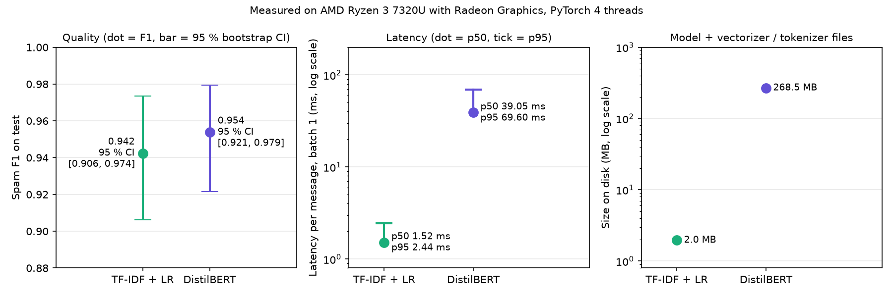
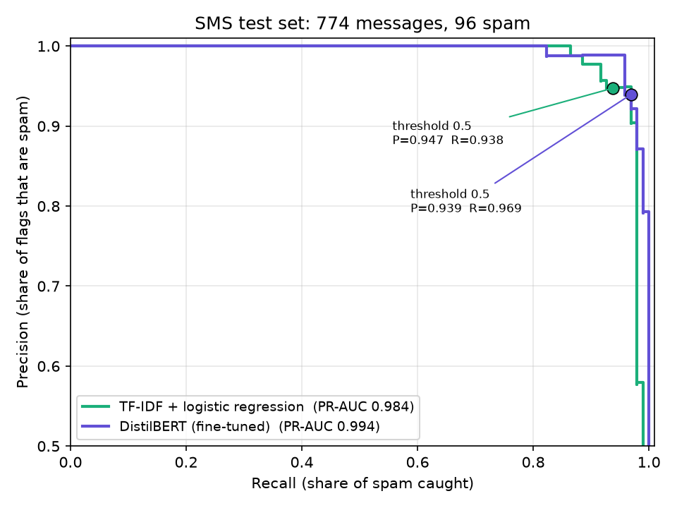

# Spam filtering: classic model vs Transformer, from a PC to a Raspberry Pi 5

[](https://github.com/amine-belkacem/spam-classic-vs-transformer-edge/actions/workflows/tests.yml)

A fine-tuned Transformer usually wins on accuracy. But a spam filter on an SMS
gateway or a small ARM board has to answer fast, in little memory, without a GPU.
I want to know, with measurements, when TF-IDF + logistic regression is enough
and when DistilBERT is worth its cost.

**Status: milestone 1 of 6 (PC only).** The Raspberry Pi 5, ONNX / int8, the
cascade and the robustness tests come next; see [the plan](#whats-next).
The full requirements are in [docs/specification.md](docs/specification.md).

## Result so far

On 774 test SMS (96 spam), the two models are **statistically tied on F1**,
while DistilBERT is **about 26 times slower** per message and **137 times larger** on disk.

| | Precision | Recall | F1 | PR-AUC | Latency p50 / p95 | Size |
|---|---|---|---|---|---|---|
| TF-IDF + logistic regression | 0.947 | 0.938 | 0.942 [0.906, 0.974] | 0.984 | 1.52 / 2.44 ms | 2.0 MB |
| DistilBERT, fine-tuned | 0.939 | 0.969 | 0.954 [0.921, 0.979] | 0.994 | 39.05 / 69.60 ms | 268.5 MB |
| Difference (DistilBERT − LR) | −0.008 | +0.031 | +0.011 [−0.019, +0.046] | +0.010 | | |

Brackets are 95 % bootstrap intervals. Latency is one message per call on an
AMD Ryzen 3 7320U laptop (4 cores), PyTorch on 4 threads, tokenizer / TF-IDF included.



What I read from this:

- **On F1, the test set cannot separate the two models.** The interval of the
  difference goes from −0.019 to +0.046, so it contains 0. In raw counts,
  DistilBERT catches 3 more spam messages (93 vs 90 out of 96) and raises one
  more false alarm (6 vs 5 out of 678 legitimate messages).
- **Where DistilBERT does look better is recall.** All 90 spam messages the
  classic model catches are also caught by DistilBERT, which adds 3 more. So
  its recall can never be lower on a resample, but the gain is small: +0.031,
  interval from 0.000 to +0.063. The PR-AUC difference (+0.010) has an interval
  that contains 0.
- **The cost gap is not borderline at all.** 39 ms vs 1.5 ms at the median.
  DistilBERT's latency follows message length closely (rank correlation 0.96
  between token count and time on the test messages): the slowest 5 % of calls
  are messages of 59 tokens at the median, against 18 for the rest.

So for this dataset, on a PC, the cheap model is the reasonable default. Whether
that still holds on an ARM board, and whether int8 or a cascade changes the
picture, is what the next milestones measure.



## How the numbers were produced

**Data.** The SMS Spam Collection has 5,574 lines but only 5,171 distinct texts,
and 12 more pairs differ only by case or spacing. Left in, a message can sit in
train and test at the same time and the test score rewards memory. I remove
duplicates on a normalised text *before* splitting: 5,159 messages remain,
642 of them spam. Spam is duplicated more often than normal messages, so the
spam rate drops from 13.4 % to 12.4 %. Then a stratified split (seed 42):
3,611 train, 774 validation, 774 test.

**Classic model.** TF-IDF on words and word pairs, plus TF-IDF on character
3-5-grams (they still match `fr33` or SMS spelling), then logistic regression.
C and the class weighting are picked on validation only. My first grid stopped
at C = 100 and the best value sat on that edge, so I extended it: past C = 1000
validation F1 changes by one message at most, so C = 1000 is kept.

**DistilBERT.** `distilbert-base-uncased` at a pinned revision, plain PyTorch
training loop (no Trainer, so I can explain every line): 3 epochs, batch 16,
learning rate 5e-5 with 10 % warm-up then linear decay, weight decay 0.01,
max 128 tokens (6 training messages out of 3,611 are longer). The best epoch on
validation is kept. I did not tune these values: the question is what an
off-the-shelf fine-tune gives. Training took 51.6 min on the laptop CPU.

**Test metrics.** `scripts/evaluate.py` is the only script that reads the test
split. Both models are scored on the same 1,000 bootstrap resamples, stratified
so that each one keeps 96 spam and 678 ham, which gives an interval for each
model and for their difference. Decision threshold 0.5 for both.

**Latency.** One message per call, raw text in, probability out. 3 runs; each
run gives every model 50 warm-up calls then 1,000 timed calls over the test
messages in a fixed order, and the model order alternates between runs. Across
the 3 runs the p50 was 1.52 ± 0.06 ms (LR) and 39.04 ± 0.12 ms (DistilBERT).
The reported p50 / p95 pool the 3,000 calls. Size on disk counts every file
needed to predict: model plus vectorizer or tokenizer.

## Things that went wrong, and what changed because of them

- **Weight decay was hitting the normalisation layers.** The usual recipe
  excludes parameters whose name ends in `LayerNorm.weight`. DistilBERT names
  most of its norms `sa_layer_norm` and `output_layer_norm`, so 12 of the 64
  parameters that should be excluded were not. I noticed right after starting
  the training, stopped it, and now exclude every 1-D parameter instead
  (biases and norm weights), which does not depend on names.
- **My first latency runs were measured on a busy machine.** Three runs in a
  row gave a DistilBERT p50 of 47, 55 then 71 ms. Another heavy job had started
  on the same laptop. None of those numbers is used. The benchmark now checks
  the system CPU load before each run and refuses to measure above 15 %.
- **The third training epoch was ~30 % slower than the first two**
  (1,215 s vs 964 s and 918 s), and I cannot say why. I could not rule out
  background load at that time, so the training time is an indication, not a
  benchmark.

## Limits

- 96 spam messages in the test set: one message moves recall by about one
  point, hence the wide intervals. A single split, a single DistilBERT seed
  (5 seeds come in milestone 2).
- English SMS collected around 2012. Spam has changed since; the YouTube
  comments test (milestone 5) is a first look at a different source.
- The precision target I set before starting (≥ 0.95 for the baseline) is not
  met: 0.947, with an interval from 0.899 to 0.989.
- Latencies are from one laptop, on mains power, Windows "Balanced" power plan.
  They show orders of magnitude, not numbers to copy to another machine.

## Reproduce

```bash
python -m venv .venv
.venv/Scripts/activate      # Linux / macOS: source .venv/bin/activate
pip install -r requirements.txt
python scripts/download_data.py          # fetches both datasets, checks SHA-256 and counts
python scripts/prepare_data.py           # de-duplication + split
python scripts/train_classic.py          # ~20 s
python scripts/train_transformer.py --seed 0   # ~50 min on a laptop CPU
python scripts/evaluate.py --seed 0
python scripts/bench_latency.py --seed 0 --threads 4   # close other programs first
python scripts/make_figures.py
pytest -v
```

## Layout

```text
src/spamedge/   data.py · split.py · classic.py · transformer.py · metrics.py · bench.py
scripts/        one script per step above
tests/          pytest, expected values worked out by hand in the comments
results/        JSON / CSV written by the scripts (committed, so the numbers can be checked)
figures/        PNG written by scripts/make_figures.py
docs/           specification written before any model code
```

## What's next

1. 5 DistilBERT seeds and an error analysis (which messages each model misses).
2. ONNX export, int8 quantisation, and the same benchmark on a Raspberry Pi 5.
3. A cascade: logistic regression first, DistilBERT only for unsure messages.
4. Robustness: obfuscated spam (`fr33 c4sh`) and SMS → YouTube domain shift.

## Data and credits

- **SMS Spam Collection**: Almeida, T. & Hidalgo, J. (2011). UCI Machine Learning Repository.
  https://doi.org/10.24432/C5CC84. CC BY 4.0.
- **YouTube Spam Collection**: Alberto, T. & Lochter, J. (2015). UCI Machine Learning Repository.
  https://doi.org/10.24432/C58885. CC BY 4.0.
- **DistilBERT** (`distilbert-base-uncased`, Sanh et al., 2019), Hugging Face, Apache-2.0.

Neither dataset is redistributed here. The YouTube files include comment authors'
names; the loader does not read that column.

## License

Code under the MIT license (see [LICENSE](LICENSE)).
